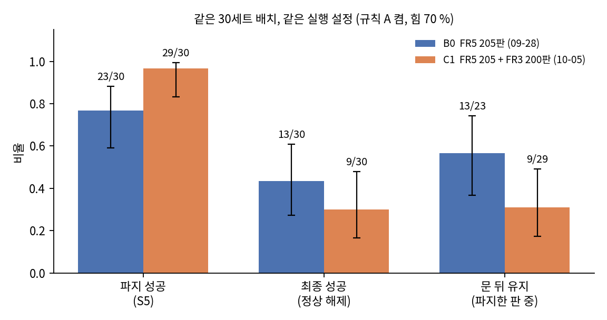
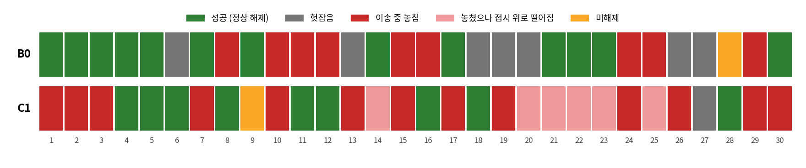
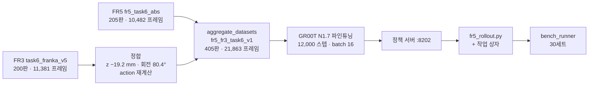
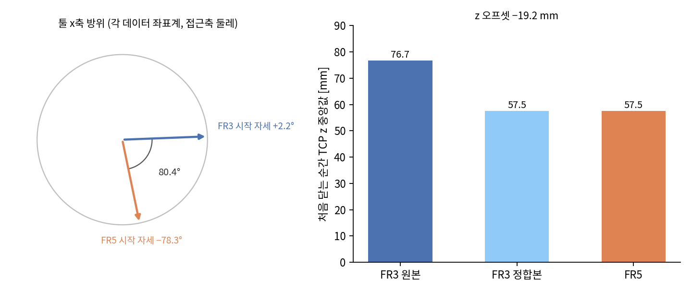
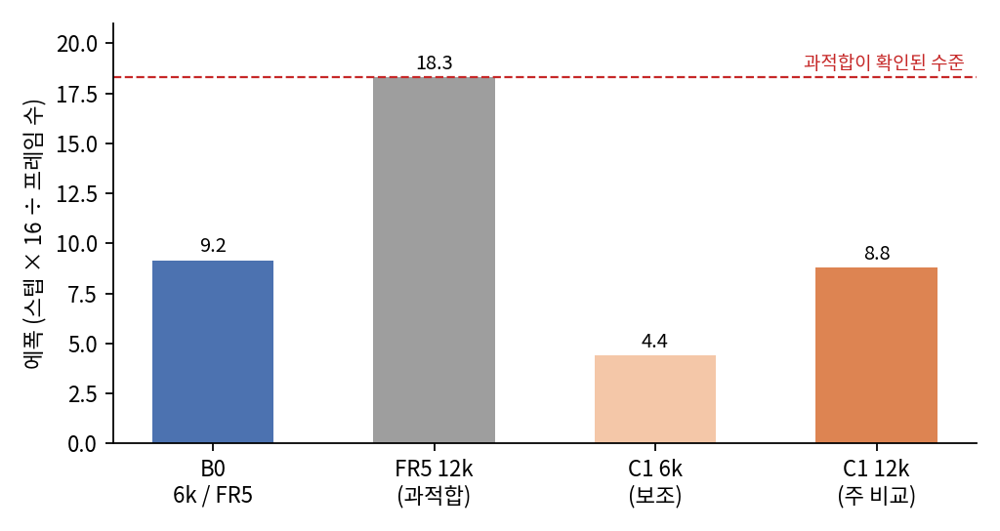
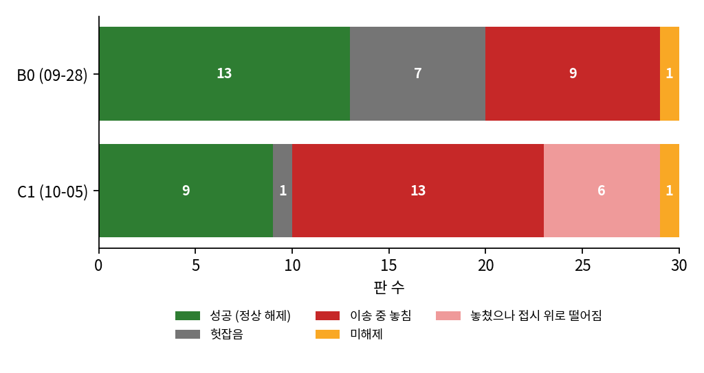
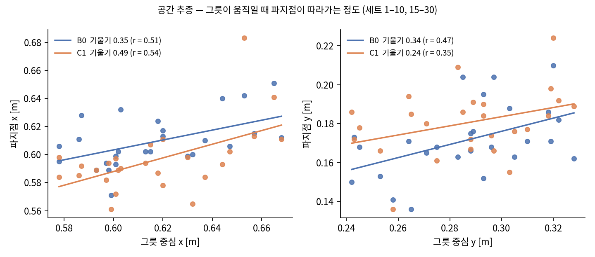
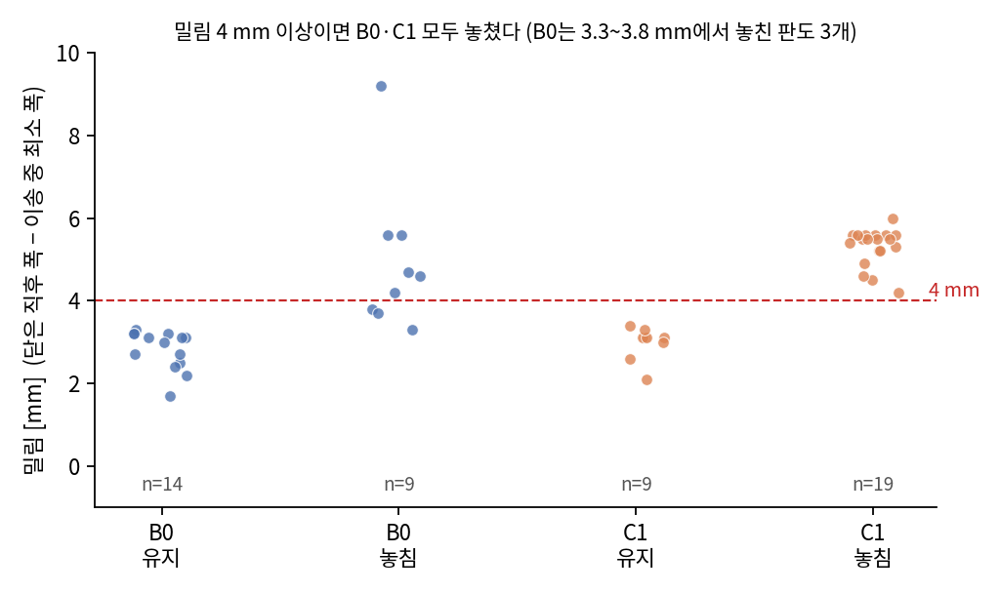
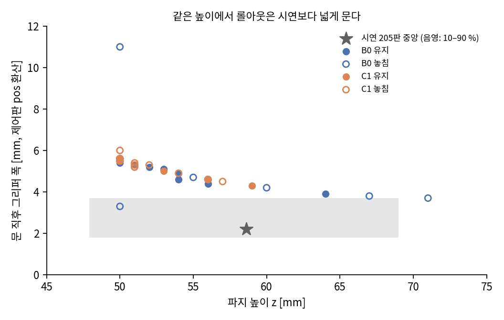
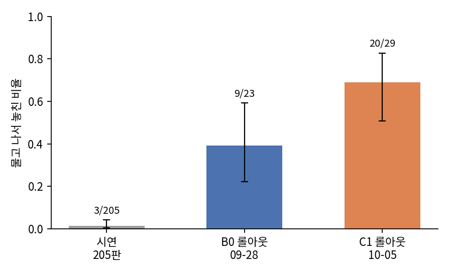

# FR3 → FR5 데이터 전이

7축 Franka FR3에서 모은 시연 200판을 6축 FAIRINO FR5 시연 205판에 섞어 GR00T N1.7을 다시 학습하고,
FR5 단독 정책과 같은 30세트 배치·같은 실행 설정에서 비교한 기록이다.

두 로봇의 태스크는 같다. 쿠키 상자 옆 검은 그릇을 집어 접시에 놓는다(LIBERO-Spatial task 0을 실물로 옮긴 것).
FR5 단독 정책의 평가와 실행 계층은 [FR5-GR00T-Benchmark](https://github.com/SungjinDavidLee/FR5-GR00T-Benchmark),
FR5 수집에 쓴 리더암은 [Leader-Feetech-FR5](https://github.com/justwooju/Leader-Feetech-FR5)에 있다.

측정일 2026-10-05 · C1 30판 · 비교 기준 B0 30판(2026-09-28)

---

## 1. 요약

| | B0 — FR5 205판 | C1 — FR5 205판 + FR3 200판 |
|---|---|---|
| 파지 성공 (S5) | 23 / 30 (76.7 %) | **29 / 30 (96.7 %)** |
| 헛잡음 | 7 | **1** |
| 최종 성공 (정책이 직접 놓은 판) | 13 / 30 (43.3 %) | 9 / 30 (30.0 %) |
| 문 뒤 끝까지 유지 | 13 / 23 | 9 / 29 |
| 실패 내역 | 헛잡음 7 · 이송 중 놓침 9 · 미해제 1 | 헛잡음 1 · 이송 중 놓침 20 |



**그림 1.** 같은 30세트, 같은 실행 설정. 오차막대는 Wilson 95 % 구간.

FR3 데이터를 섞자 **파지가 좋아졌다.** 같은 배치끼리 짝지어 보면 B0가 헛잡음으로 놓친 7세트 중 6세트를 C1이
잡았고, 반대로 B0는 잡았는데 C1이 놓친 세트는 없었다(McNemar 정확검정 p = 0.031).

**최종 성공률은 갈리지 않는다.** B0만 성공한 세트가 11개, C1만 성공한 세트가 7개로 흩어져 있다(p = 0.48).
C1 실패 21판 중 20판이 그릇을 문 뒤 이송 중에 놓친 판이고, 놓친 판은 모두 밀림이 4.2 mm 이상이었다.
이 실패는 정책보다 그리퍼 접촉 쪽 문제로 보고 있다([8절](#8-미끄러짐)).



**그림 2.** 세트별 결과. 위 B0, 아래 C1이고 같은 열이 같은 배치다. 분홍색은 그릇을 놓쳤는데 우연히 접시 위로
떨어진 판으로, 성공으로 세지 않았다.

---

## 2. 진행 흐름



| 단계 | 내용 | 문서 |
|---|---|---|
| 출발점 | 목표 설정, 전제 정리, 목표가 바뀐 과정 | [01_background](docs/01_background.md) |
| 데이터 감사 | 두 데이터셋의 형식·주기·회전 규약·카메라 | [02_data_audit](docs/02_data_audit.md) |
| 정합과 합치기 | 축 확인, z·회전 보정, 데이터셋 합치기 | [03_alignment](docs/03_alignment.md) |
| 커버리지 판정 | FR3가 FR5의 빈 영역을 덮는지 — 덮지 않았다 | [04_coverage](docs/04_coverage.md) |
| 학습과 서버 | 학습 설정, 스텝 근거, 서버 버그 수정 | [05_training](docs/05_training.md) |
| 안전과 운영 | 작업 상자, 시운전, 운영 중 생긴 일 | [06_safety_and_ops](docs/06_safety_and_ops.md) |
| 결과 | 30판 판별, 대응 비교, 공간 추종 | [07_results](docs/07_results.md) |
| 미끄러짐 | 시연은 안 미끄러지는데 롤아웃은 미끄러지는 이유 | [08_slip](docs/08_slip.md) |
| 한계와 다음 | 미측정 항목, 마찰 실험 설계 | [09_limitations_next](docs/09_limitations_next.md) |
| 재현 | 기계별 명령 순서 | [10_runbook](docs/10_runbook.md) |

---

## 3. 데이터

```
FR3   task6_franka_v5   200판 / 11,381 프레임   Franka FR3 + Franka Hand   GELLO 7축 리더
FR5   fr5_task6_abs     205판 / 10,482 프레임   FAIRINO FR5 + DH AG-95     U-Arm 6축 리더
공통  LeRobot v3.0, 명목 10 fps, 카메라 RealSense D405 ×2 (3인칭·손목), 256×256
      state 8 = x, y, z, aa1, aa2, aa3, gripper, −gripper     action 7 = 다음 프레임 state 앞 7개
```

형식은 처음부터 같았다. 두 데이터 모두 `action[t] = state[t+1][:7]`이 오차 0으로 성립한다. 다른 것은 좌표 규약이다.

| | FR3 | FR5 |
|---|---|---|
| 기준 좌표계 | 로봇 base | base를 z축 −77.2° 돌린 작업 프레임 |
| 시작 자세 툴 x축 방위 | +2.2° | −78.3° |
| 처음 닫는 순간 TCP z (중앙) | 76.7 mm | 57.5 mm |
| 실제 기록 주기 | 약 2.8 Hz (1판 확인) | 약 3.4 Hz |

자세한 내용은 [docs/02_data_audit.md](docs/02_data_audit.md).

---

## 4. 정합



**그림 3.** 왼쪽: 두 데이터의 시작 자세 툴 x축 방위. 오른쪽: 처음 닫는 순간의 TCP 높이.

FR3 쪽만 고쳐 FR5 규약에 맞췄다. 원본은 건드리지 않고 사본(`fr3_task6_aligned_v1`)을 만들었다.

```
z      −19.2 mm         처음 닫는 순간 TCP z 중앙값을 FR5에 맞춤
회전   툴 좌표계 80.4°   시작 자세 평균끼리 맞춤, 축각은 판 안에서 연속 표현
action 다시 계산         action[t] = state[t+1][:7]
검증   action 오차 0, 시작 자세 차 0.00°, 판 안 축각 최대 점프 0.347 rad (표현 갈림 없음)
```

y축 부호는 바꾸지 않았다. 접시가 그릇 오른쪽인 FR3 판 7개는 모두 dy > 0, 왼쪽인 판 6개는 모두 dy < 0으로
FR5와 같은 규약이었다. xy 위치는 맞추지 않았다. 두 장면을 잇는 공통 기준점(인덕션 좌표 등)을 FR3 쪽에서 잴
수 없었기 때문이다.

---

## 5. 학습

B0 학습 설정을 그대로 쓰고 데이터셋·출력 경로·스텝만 바꿨다.

```
기반       nvidia/gr00t17-lerobot-libero_spatial-640  (GR00T N1.7-3B)
embodiment new_embodiment 하나 — FR3와 FR5를 같은 로봇으로 학습
설정       batch 16 · chunk 32 · use_relative_actions (그리퍼 제외) · lr 1e-4 cosine · seed 1000
스텝       12,000 (주 비교) / 6,000 (보조)
소요       1시간 15분 · RTX PRO 6000 1장 · 메모리 36 GB
loss       0.882 (50스텝) → 0.044 (400) → 0.006 (12,000)
```



**그림 4.** 학습량을 에폭으로 비교. C1 12k는 FR5 프레임 하나를 보는 횟수가 B0와 거의 같다.

과적합은 스텝 수가 아니라 같은 샘플을 몇 번 보느냐로 정해진다. FR5 205판을 12,000스텝(18.3 에폭) 학습한
체크포인트는 공간 추종이 0.35에서 0.1로 무너졌다. 합친 데이터에서 12,000스텝은 8.8 에폭으로 B0(9.2)와 비슷해,
FR5 학습량을 고정하고 차이를 FR3 추가 효과로 좁힐 수 있다. 주 비교는 12,000스텝으로 평가 전에 정했다.

---

## 6. 평가 설정

학습 데이터 외에는 9/28 B0 측정과 같게 맞췄다.

| 항목 | 값 |
|---|---|
| 배치 | 세트 1~30 (FR5-GR00T-Benchmark `layouts.csv`), 로봇이 좌표를 짚어주는 방식 |
| 파지 구간 하강 (규칙 A) | 켬 — 목표 z −8 mm, 하한 50 mm (`GRASP_DZ=0.008`) |
| 그리퍼 | 힘 70 %, 문 뒤 완전 폐쇄 유지 (`LATCH_MODE=full`) |
| 경로 속도 | 관절 6 °/s, 청크 32개를 한 경로로 |
| 회전 | 정책 회전 출력을 쓰지 않고 시작 자세 유지 |
| 추론 | denoise 16, 1회 약 390 ms |
| 기록기 | 세트 1~10 `bench_runner.py`(v1), 11~30 `bench_runner_v3.py` — 로봇 동작은 같고 기록 항목만 다르다 |
| 추가된 것 | 작업 상자 (x 0.37~0.82, y −0.08~0.44, z ≤ 0.39) — 30판 동안 발동 0회 |

규칙 A는 절제 실험에서 해롭다고 밝혀진 규칙이다. 그래도 B0 기록과 학습 외 조건을 맞추기 위해 켠 채로 쟀다.
두 정책이 같은 불리함을 안고 비교되므로 비교 자체는 공정하다.

**판정 기준.** 롤아웃이 `놓음`(`end_why = released`)으로 끝난 판만 성공으로 셌다. 9/28 B0의 성공 13판도 모두
정책이 직접 놓은 판이다. 그릇이 미끄러져 우연히 접시에 떨어진 C1 6판(세트 14, 20, 21, 22, 23, 25)은 현장에서
`s`로 눌렀지만 실패(이송 중 놓침)로 다시 분류했다.

---

## 7. 결과



**그림 5.** 결과 유형별 판 수.



**그림 6.** 그릇 위치와 실제 파지점. 배치 좌표가 로그로 확인된 26세트(1~10, 15~30)만 썼다.

헛잡음이 7판에서 1판으로 줄었지만 공간 추종 기울기는 뚜렷하게 좋아지지 않았다(x 0.35 → 0.49, y 0.34 → 0.24).
대신 파지점의 평균 위치가 y로 9 mm 그릇 쪽으로 옮겨 갔다(그릇 중심 대비 −115 → −106 mm). B0 헛잡음 판은 대부분
그릇에서 멀리 문 판이었다. 헛잡음 감소가 이 이동과 관련됐을 수 있지만 판수가 적어 확정하지 않는다.

세트별 전체 표와 통계는 [docs/07_results.md](docs/07_results.md).

---

## 8. 미끄러짐



**그림 7.** 문 뒤 밀림(닫은 직후 폭 − 이송 중 최소 폭). 4 mm를 넘으면 B0·C1 모두 예외 없이 놓쳤다. C1은 유지 3.4 mm 이하,
놓침 4.2 mm 이상으로 깨끗하게 갈리고, B0(09-28)는 3.3~3.8 mm에서 놓친 판도 3개 있었다.



**그림 8.** 파지 높이와 문 직후 폭. 롤아웃 점은 높이에 따라 한 곡선 위에 놓이는데, 시연 205판(음영)은 같은 높이에서
훨씬 좁게 물었다.



**그림 9.** 물고 나서 놓친 비율. 시연 205판은 3판(1.5 %)뿐이다.

시연 때는 지연이 걸린 순간을 빼면 거의 미끄러지지 않았다. 시연의 그리퍼 값이 리더 명령이 아니라 제어판
실측값(`gripper.pos`)이라는 것도 수집기 코드로 확인했다. 같은 그릇·같은 그리퍼인데 롤아웃에서만 놓친다.

원인 후보를 하나씩 확인했다.

| 후보 | 확인 방법 | 결과 |
|---|---|---|
| 파지 높이 | 시연·롤아웃 높이 범위 비교 | 범위가 겹친다. 시연 안에서 밀림과 높이의 상관 0.00 |
| 손목 각도 | 시연 파지 순간 yaw −15.1°(205판 모두 같은 방향) → 롤아웃에 −15° 고정 회전 | 3판 모두 폭 3.9~5.1 그대로, 2판 놓침. 원인 아님 |
| 기록기 차이 | v1 / v3 diff | 기록 항목만 다르고 힘 적용 절차는 같다 |
| 그리퍼 힘 | 수집 코드·제어판 확인 | 수집 때 힘을 설정한 코드가 없다. 그때 값은 알 수 없다 |
| 날짜·장비 상태 | 같은 높이·폭(≥ 5.4 mm) 판의 유지율 | B0(9/28) 7/10, C1(10/05) 6/19 (p = 0.064) |

과자 상자를 그릇과 같이 물었을 때는 미끄러지지 않았다. 평평하고 마찰이 큰 면이 손가락 한쪽에 들어가면
경사진 유약면에서 생기는 쐐기 효과가 사라진다. 지금 판단은 **이송 실패의 근본 원인이 그리퍼 접촉면의 마찰**이라는
것이고, 다음 단계에서 손가락 패드로 확인한다. 마찰을 올렸을 때 이송 성공이 얼마나 오르는지는 아직 재지 않았다.

자세한 조사 과정은 [docs/08_slip.md](docs/08_slip.md).

---

## 9. 실물에서 관찰한 것

수치로 잰 것은 아니지만 판단에 쓴 관찰이다.

- C1은 B0가 못 집던 자리(인덕션 오른쪽 끝보다 왼쪽에 놓인 그릇)에서도 집었다. 시도한 판에서는 모두 집었고,
  놓는 단계에서 실패했다.
- C1은 **접시 위치를 외웠다.** 접시를 FR5 데이터에 없던 자리로 옮기면 원래 접시 자리나 그 사이의 쿠키 상자 위에
  놓는다. FR5 시연의 배치 지점이 x 0.690~0.765, y −0.008~0.094(10~90 %)에 몰려 있어 정책이 접시를 볼 필요가
  없었다. FR3에는 접시가 여러 곳에 있었지만 이 문제를 풀지 못했다.

---

## 10. 한계

- **B0와 C1의 측정일이 다르다**(09-28 / 10-05). 학습 외 설정은 맞췄지만 장비 상태 변화는 배제하지 못했다.
  같은 날 B0 재측정이 다음 작업이다.
- 판수 30. 파지 비교는 대응 검정에서 p = 0.031이지만, 독립 비교(피셔)로는 p = 0.052로 경계에 있다.
- FR3 쪽은 실물을 만질 수 없어 xy 장면 정렬, 카메라 외부 파라미터, 고정물 좌표를 잴 수 없었다.
- 실제 기록 주기가 FR3 약 2.8 Hz, FR5 약 3.4 Hz로 다른데 재샘플링하지 않았다.
- 기록기가 세트 1~10과 11~30에서 달랐다. 로봇 동작은 같지만 1~10의 밀림 값은 롤아웃 로그에서 옮겨 적었다.

---

## 11. 다음

1. 오늘 설정 그대로 B0 10판 재측정 — 문 뒤 유지율이 날짜 문제인지 정책 문제인지 가른다.
2. 손가락 마찰 패드를 붙이고 B0·C1을 같은 날 번갈아 30판씩. 정책 × 그리퍼 2×2로 데이터 효과와 마찰 효과를 나눠 읽는다.
3. 접시 위치를 바꿔 FR5 시연을 추가하거나, FR3 xy를 장면 기준으로 정렬하는 방법을 찾는다.

---

## 파일 구성

```
README.md
docs/
  01_background.md … 10_runbook.md
  ref/                    다른 대화·저장소에서 넘겨받은 정리 문서
data/
  b0_20260928.csv         B0 30판 판별 (FR5-GR00T-Benchmark RESULTS 9절)
  c1_main_20261005.csv    C1 30판 판별 (bench_runner.csv + 롤아웃 로그, 엄격 판정 포함)
  yaw_test_20261005.csv   손목 고정 회전 시험 4판
  fr3_fr5_c1_checkpoint_plan.xlsx   학습량 비교·dry 추종 확인 양식
fig/                      그림 (fig01~09는 data/로 다시 그릴 수 있다)
tools/
  01_audit/ 02_coverage/ 03_align_merge/ 04_train_serve/ 05_robot/ 06_analysis/
```

그림 1~9는 `python3 tools/06_analysis/make_figs.py`로 다시 만든다. 그림 10~14는 분석 중에 데이터에서 직접 뽑은 것이다.

내부 주소와 계정은 `TRAIN_SERVER_IP`, `FR3_USER` 같은 자리표시로 바꿔 두었다. 목록은 [docs/10_runbook.md](docs/10_runbook.md) 맨 위에 있다.
