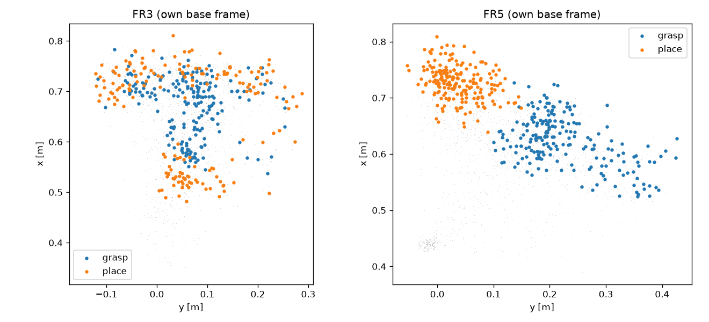

# 2. 데이터 감사

## 2.1 기계

```
FR3 제어 PC     FR3-PC     FR3 데이터·FR5 LeRobot 사본 보관, FR3 로봇 연결(FR3_ROBOT_IP)   — 실물 조작 불가
워크스테이션    WORKSTATION_IP    분석·정합. 루트 디스크가 차서 /home/data/fr_transfer 에서 작업
학습 서버       TRAIN_SERVER_IP    RTX PRO 6000 ×2, LeRobot + GR00T, 정책 서버
FR5 제어 PC     Jetson AGX Thor 제어판(fr5d.py), 롤아웃, bench_runner
```

FR3 제어 PC는 `tools/01_audit/fr_discovery.sh`(읽기 전용)로 훑었다. `enp3s0`에 `FR3_ROBOT_IP`가 붙어 있고
franka_ros2·libfranka·Franka용 GELLO가 있어 FR3 제어 PC로 확인됐다. USB에는 RealSense D405 두 대가 있었다.

## 2.2 찾은 데이터

```
~/.cache/huggingface/lerobot/local/
  task6_franka_v1   11판     초기 버전
  task6_franka_v2   101판
  task6_franka_v3   101판    그리퍼 action 이 binary(1.0)
  task6_franka_v4   101판    그리퍼 action 이 폭(m)
  task6_franka_v5   200판    v4 를 포함하는 최종본 (0번 판 값이 v3~v5 에서 같다)   ← 사용
  fr5_task6_abs     205판    FR5                                                   ← 사용
~/openvla_franka/task6/collect/episodes_groot/   FR3 원본 201개 디렉터리, 2026-09-11 ~ 09-15
```

v3와 v4는 그리퍼 action 규약이 달라 섞으면 안 된다. v5만 썼다.

## 2.3 형식

두 데이터셋의 features가 완전히 같다(`feature_check.py`).

| 항목 | 값 |
|---|---|
| 형식 | LeRobot v3.0, 명목 10 fps |
| 영상 | `observation.images.image` (3인칭), `observation.images.wrist_image` (손목), 256×256 |
| state | 8 = x, y, z, aa1, aa2, aa3, gripper, −gripper (m, 축각 rad, 그리퍼 m) |
| action | 7 = 다음 프레임 state의 앞 7개, 마지막 프레임은 자기 자신 |
| 태스크 | `pick up the black bowl next to the cookie box and place it on the plate` |

action이 "보낸 명령"이 아니라 "실제로 도달한 다음 상태"라는 점이 중요하다. 샘플 3스텝에서 `action[t]`와
`state[t+1]`이 정확히 같았고, 이후 전체에서 오차 0으로 확인했다.

## 2.4 주의할 점

**실제 기록 주기.** 명목은 10 Hz지만 FR5는 약 3.4 Hz(205판 평균), FR3는 ep_033 한 판이 62프레임 / 22.0초로 약
2.8 Hz였다. 한 스텝의 길이가 두 데이터에서 20 % 정도 다르다.

**축각 표현.** 이 태스크의 손끝 자세는 회전 크기가 π 근처라 같은 회전을 두 가지 벡터로 쓸 수 있다. FR3 v5는 변환
단계에서 첫 성분을 양수로 맞춰 크기가 π를 넘는 값(최대 3.61)이 있다. 성분끼리 빼면 ±π 경계에서 값이 튄다.
회전 차이는 회전행렬로 계산해야 한다.

**그리퍼.** FR3 state의 그리퍼 쌍은 0.04 / −0.04, 최대 0.0405로 Franka Hand 손가락 값이다. FR5는 AG-95 위치
0~1000을 `pos / 1000 × 0.04`로 바꿔 같은 범위에 넣었다. 두 데이터 모두 연속값이다(고유값 856 / 665개).

**FR3 README의 규약은 v5와 무관하다.** `collect/README.md`의 속도 규약(action × 0.05 m/s, Y 반전, 1 = OPEN)은 OpenVLA
파이프라인용이다. v5는 GELLO로 수집한 절대 pose다.

**카메라.** 두 로봇 모두 D405 두 대다. FR5 셀 URDF에 D455 mesh가 들어 있어 처음에 FR5가 D455라고 추정했는데
틀렸다(FR5-GR00T-Benchmark RESULTS 2.1). FR5 손목 카메라는 광축 기준 180° 돌아 장착돼 있다.

**FR3 카메라 이동.** `camera_before/NOTE.md`에 따르면 3인칭 카메라를 2026-08-27에 옮겼다. v5는 9/11~9/15에 모았으므로
전부 이동 후 위치다.

**`collect/calib.json`은 외부 파라미터가 아니다.** 16점으로 푼 카메라 → 로봇 3D affine인데, 카메라 쪽 z가 모든 점에서
0.826으로 같아 평면 대응에 가깝고, A가 회전행렬이 아니며 평균 오차가 16 mm다. 로봇 렌더링(RoVi-Aug류)에는 쓸 수 없다.

## 2.5 그 밖에 찾은 것

| 위치 | 내용 |
|---|---|
| `~/openvla_franka/task6/space/` | FR3 쪽 SPACE action adapter 구현과 캘리브레이션 기록(9/21). 속도 명령 기준 |
| `~/Downloads/ik_franka_fr5.py` | FR5 해석적 IK(해 최대 8개)와 Franka 수치 IK 참고 구현 |
| `~/franka_web/robots/fr5/fr5_cell.urdf` | FR5 셀 모델. `table_link`(0.65 × 0.64 m)는 base가 가운데 있는 받침대다. 파지 위치 x 0.52~0.73 m가 그 밖이라 작업대가 아니다 |
| `~/groot-fr3-task6` | FR3 쪽 GR00T N1.7 파이프라인. FR3 기록 30판 53.3 % |
| `~/gello_backup/.../calib_final.json` | FR3 GELLO 관절 부호·오프셋 |

## 2.6 1차 비교

`tools/01_audit/phase1_check.py`로 두 데이터를 같은 방식으로 요약했다.

| | FR3 (v5) | FR5 |
|---|---|---|
| 판 / 평균 길이 | 200 / 56.9 프레임 (44~91) | 205 / 51.1 (31~125) |
| 시작 xyz 평균 [m] | 0.427, 0.021, 0.396 | 0.438, −0.018, 0.292 |
| 파지 xyz 범위 [m] | x 0.537~0.784, y −0.117~0.254 | x 0.525~0.727, y 0.100~0.426 |
| 배치 xyz 범위 [m] | x 0.482~0.811, y −0.121~0.287 | x 0.640~0.809, y −0.054~0.149 |
| 툴 기울기 중앙 / p95 | 10.9° / 24.5° | 4.1° / 10.8° |
| 시작 자세 툴 yaw | +2.2° ± 3.4° | −78.3° ± 1.6° |
| 프레임당 이동 중앙 / p95 | 10.5 / 61.3 mm | 18.9 / 55.2 mm |

시작 자세 회전 차이는 툴 좌표계에서 80.4°(euler xyz −0.6, 1.3, 80.4)다.



**그림 10.** 파지점(파랑)과 배치점(주황). FR3는 파지점이 T자 모양으로, 두 줄을 따라 의도적으로 배치했다. FR5는
배치점이 한 구역에 몰려 있다. 그림 제목의 "own base frame"은 FR3에만 맞고, FR5는 작업 프레임 기준이다.
