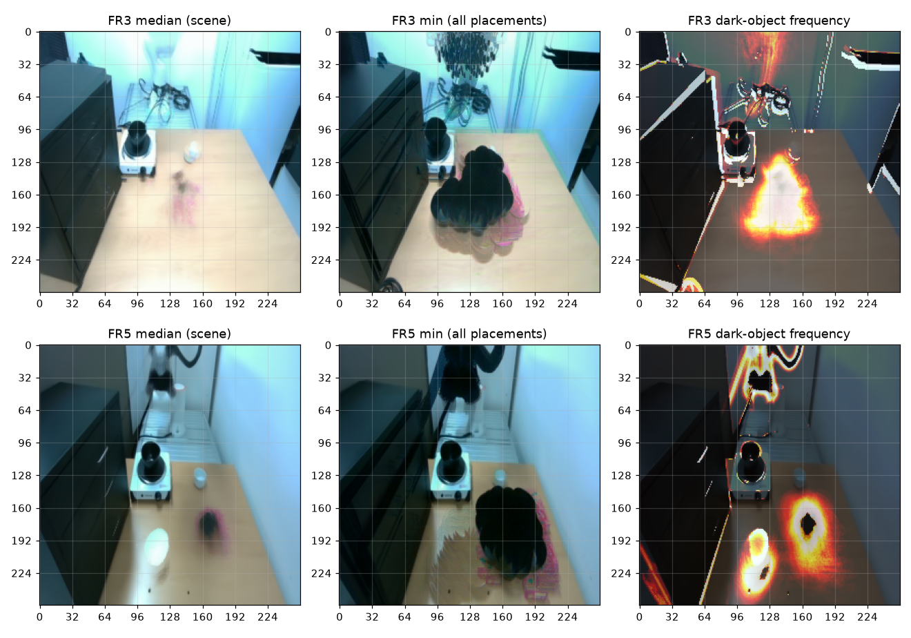
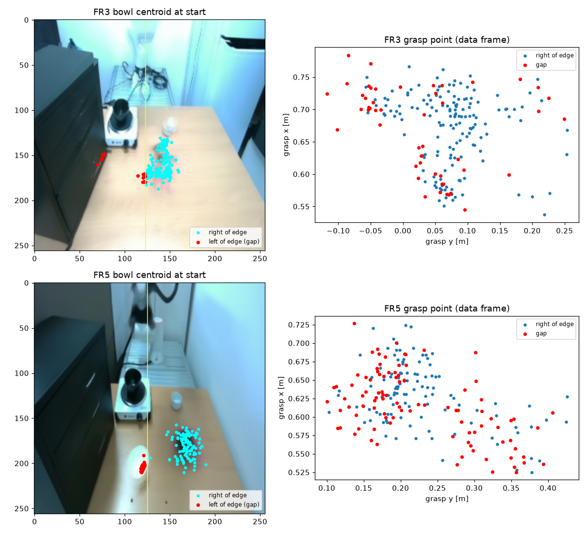
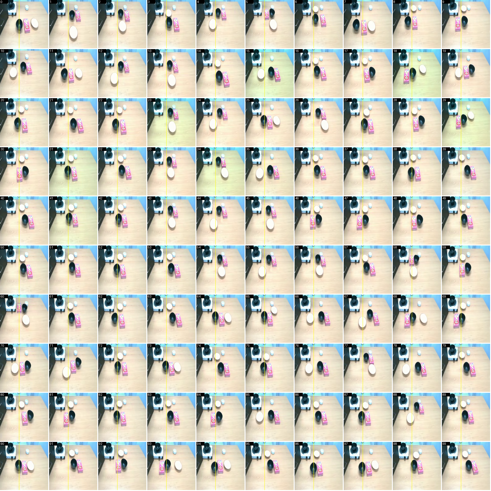
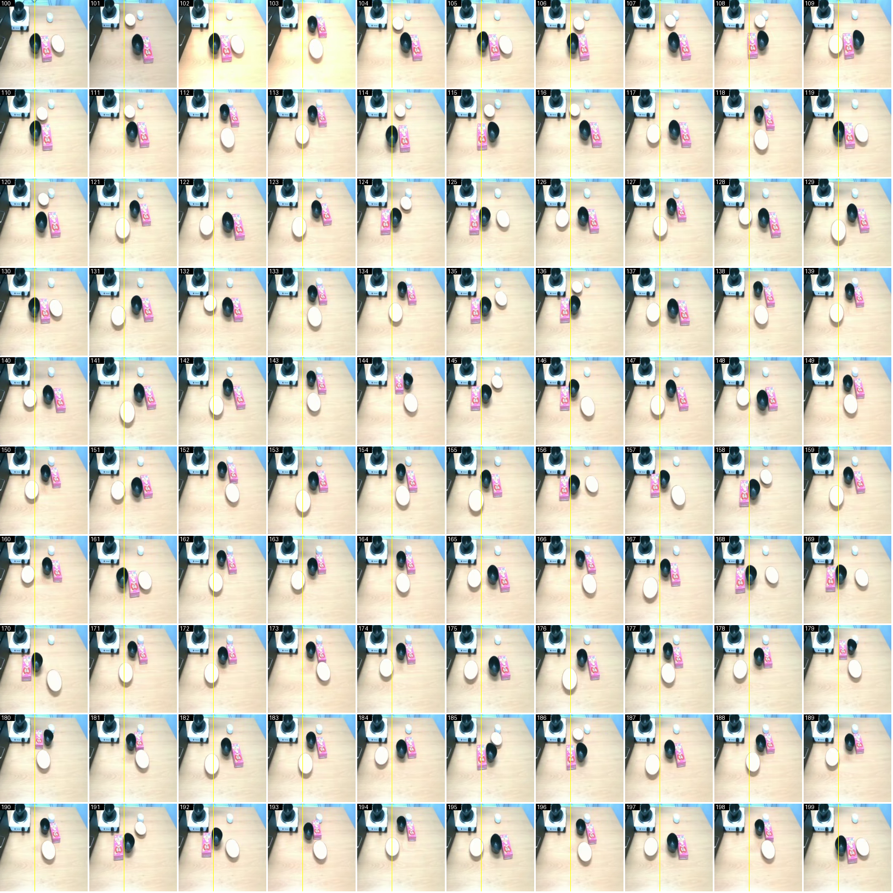

# 4. 커버리지 판정 — FR3가 FR5의 빈 영역을 덮는가

## 4.1 질문

FR5 정책은 그릇이 인덕션 오른쪽 끝보다 왼쪽(화면 기준)에 놓이면 집지 못했다. FR3 데이터에 그 자리 파지가
충분히 있다면, FR3 데이터로 그 영역을 메우는 실험이 된다.

FR3 실물은 만질 수 없어 장면 좌표(인덕션 위치)를 잴 수 없었다. 대신 3인칭 카메라가 고정이라 인덕션이 화면에서
늘 같은 자리에 있다는 점을 이용해, 각 판의 시작 프레임으로 판정했다.

## 4.2 방법 1 — 시작 프레임 합성

`tools/02_coverage/coverage_check.py`. 각 판 시작 프레임의 중앙값(장면), 최솟값(모든 배치를 겹친 것), 중앙값보다
크게 어두운 픽셀의 빈도를 그렸다.



**그림 11.** 위 FR3, 아래 FR5. FR5 그릇은 전부 인덕션 오른쪽 끝(약 125열)보다 오른쪽이다. 인덕션 앞쪽은 FR5에서
접시가 놓이는 자리다(아래 오른쪽 그림의 흰 원 주변 고리).

FR3의 최솟값 합성은 85열까지 퍼져 보여 처음에 "조건부 go"로 판단했다. 이 판단은 틀렸다. 최솟값 합성은 그릇 윤곽의
합집합이라, 왼쪽 경계가 가장 왼쪽 그릇 중심보다 반지름(약 15 px)만큼 더 나온다.

## 4.3 방법 2 — 자동 검출 (실패)

`tools/02_coverage/gap_count.py`. 판마다 검은 그릇을 찾아 중심이 경계 열보다 왼쪽인 판을 셌다. 결과는
FR3 49판, FR5 97판이었는데 둘 다 틀렸다.



**그림 12.** 검출 결과. 빨간 점이 "경계 왼쪽"으로 센 판이다.

- **FR5 97판:** 빨간 점이 전부 흰 접시 자리에 모였다. 배경을 프레임별 밝기의 90백분위로 잡았는데, 그 자리에서는
  흰 접시가 배경이 됐다. 접시가 치워진 판에서 드러난 나무 바닥이 배경보다 어두워 "검은 물체"로 잡혔다.
- **FR3 49판:** 일부는 작업대 밖 캐비닛 가장자리에 찍혔다. 나머지를 파지 좌표로 옮기면 모든 군집에 흩어진다.
  그릇이 정말 한 영역에 놓인 판들이라면 파지 좌표에서도 한 덩어리여야 한다.

검출기를 고치는 대신 눈으로 세는 쪽을 택했다.

## 4.4 방법 3 — 시작 프레임 시트로 직접 세기

`tools/02_coverage/fr3_sheet.py`. FR3 200판의 시작 프레임을 작업대 부분만 잘라 100장씩 시트로 만들었다. 노란 선은
인덕션 오른쪽 끝 참고선(123열)인데, 실제 인덕션 본체의 오른쪽 끝은 그보다 왼쪽(약 113~118열)이다.





**그림 13, 14.** FR3 시작 프레임 0~99번, 100~199번. 각 칸 왼쪽 위 숫자가 판 번호다.

```
그릇이 인덕션 앞쪽(경계 왼쪽)에 확실히 놓인 판    7, 8, 11            3판 (1.5 %)
그릇 중심이 참고선에 걸친 판                      0, 20, 22, 25, 31, 38, 41, 42, 52, 64, 65, 73, 75, 87, 90, 94, 97, 100 …   약 30판
```

축소 이미지 판독이라 ±5 px 정도 오차가 있다. 참고선이 실제 경계보다 오른쪽에 있으니, 실제 경계로 보면 걸친 판도
대부분 오른쪽으로 빠진다.

## 4.5 판정

**no-go.** FR3 작업대가 넓은 것은 맞다. 파지점 분포 폭이 FR3 25 × 37 cm, FR5 20 × 33 cm다. 하지만 넓은 방향이 인덕션
쪽이 아니다. FR3도 그릇은 쿠키 상자 옆 중앙 띠에 몰려 있다.

대신 FR3가 확실히 넓게 덮는 축이 있었다. 접시 위치다.

```
FR5 배치 지점   x 0.690~0.765   y −0.008~0.094   (10~90 %)   늘 인덕션 앞쪽 한 구역
FR3 배치 지점   x 0.482~0.811   y −0.121~0.287   T자 분포    인덕션 앞, 쿠키 상자 오른쪽, 그릇 앞쪽 모두
```

이 축으로 실험을 다시 잡는 안을 세웠지만, 목표를 "FR5 성공률을 올리는 것"으로 단순하게 바꾸면서 커버리지 실험은
접었다([01_background.md](01_background.md)). 나중에 실물에서 C1이 접시 위치를 외운 것이 확인됐다. FR3의 다양한 접시
위치는 이 문제를 풀지 못했다([07_results.md](07_results.md) 7.6).

## 4.6 dry 추종 확인 (일부만)

로봇을 움직이지 않고 같은 관측을 세 서버(B0, C1-6k, C1-12k)에 보내 예측 파지점을 비교하는 탐침
(`tools/05_robot/dry_probe.py`)을 만들었다. 한 배치(L7)만 쟀고, 그때 배치 안내가 리더 추종이 꺼진 상태라 로봇이
움직이지 않아 그릇 좌표를 신뢰할 수 없었다. 결과는 기록만 남긴다.

```
L7 (입력 그릇 0.599, 0.310 — 실제 위치 불확실)
  B0      예측 파지점 (0.641, 0.185)   반복 편차 4.6 / 6.6 mm
  C1-6k   예측 파지점 (0.646, 0.164)   반복 편차 19.2 / 40.7 mm
  C1-12k  예측 파지점 (0.625, 0.203)   반복 편차 5.5 / 3.6 mm
```

이후 실물에서 C1-12k가 그릇을 잘 따라 집는 것이 보여, dry 확인 대신 그 관찰로 "12k 과적합 없음"을 판단했다.
